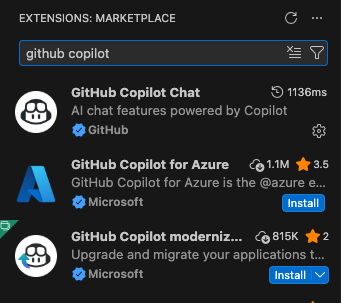
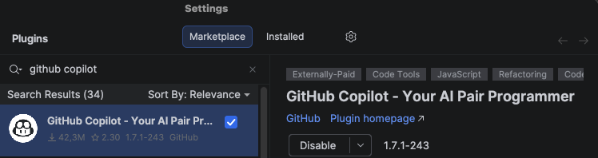
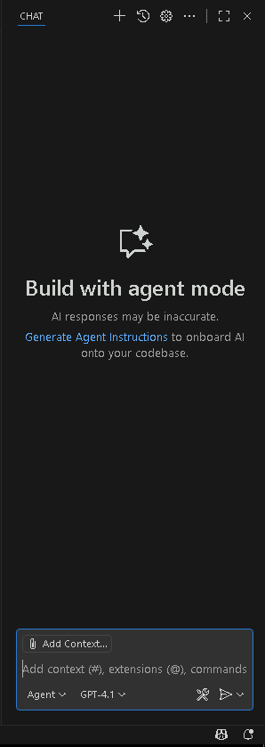
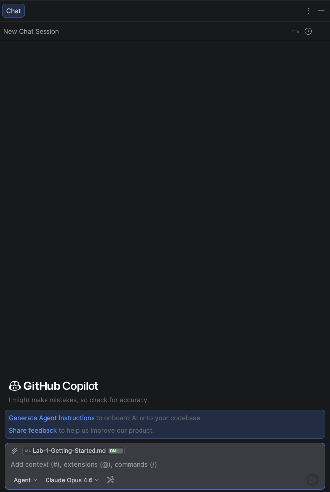

# Lab 1 - Lab Overview and Setup

#### Duration: 15 minutes

## Overall Lab Objectives

This hands-on lab gives you practical experience using **GitHub Copilot** as an AI-powered assistant throughout the development lifecycle. You'll work with a real codebase and learn how Copilot can help you move faster without cutting corners on quality or security.

Through a series of guided exercises, you'll learn how to:

- Use GitHub Copilot's code completions directly in your IDE
- Have productive conversations with Copilot Chat in Ask and Agent modes
- Let Agent mode tackle multi-file tasks autonomously
- Customize Copilot with instruction files, prompt files, and chat modes
- Detect and fix security vulnerabilities using Copilot and Secure by Design principles
- Understand when to trust Copilot's output and when to push back

## Welcome to The Daily Harvest

🍎 **Your Mission: Develop your daily pick of fresh code!**

You've joined **The Daily Harvest**, a startup building a backend API for fruit e-commerce platforms.

### Your Role

As a new developer, you'll extend API functionality, improve tests, and use **GitHub Copilot** to work faster while keeping quality high.

### The Challenge Ahead

In this lab, you'll focus on:

- Understanding and navigating the existing codebase
- Improving test coverage across critical API components
- Planning and implementing a shopping cart API
- Maintaining code quality standards across the team
- Identifying and resolving security vulnerabilities

Speed matters, but quality and security are non-negotiable. You'll use GitHub Copilot to balance both.

Let's get started! 🍊

## Setting Up Your Environment

### Prerequisites

### GitHub Copilot License

You need an active GitHub Copilot license. If your organization uses Omegapoint's GitHub Enterprise, join the Copilot group via [this link](https://myaccount.microsoft.com/groups/ad8903a5-9a02-4d36-b906-afa5ee8b283b).

Make sure you sign in to your IDE with your GitHub Enterprise account when setting up Copilot.

### API Client

Several labs require calling REST endpoints while the API is running. Use whichever API client you're comfortable with:

- [Bruno](https://www.usebruno.com/)
- [Postman](https://www.postman.com/)
- Or just `curl` from the terminal — it's plenty for everything in this lab.

## Creating Your Repository

1. Go to the **copilot-lab** template repository:

   ```
   https://github.com/Omegapoint/copilot-lab
   ```

2. Click **Use this template** to create your own copy.

   

3. Once the repository is created, clone it locally:

   ```bash
   git clone https://github.com/<your-username>/<your-repo-name>.git
   cd <your-repo-name>
   ```

## Setting Up Your IDE

1. Open the cloned repository in an IDE that supports GitHub Copilot (VS Code, IntelliJ, WebStorm, etc.).

2. Install the **GitHub Copilot** extension:

   - **VS Code**: Go to Extensions (`Cmd+Shift+X` / `Ctrl+Shift+X`), search for "GitHub Copilot", and install it.
   - **JetBrains**: Go to Settings → Plugins → Marketplace, search for "GitHub Copilot", and install it.

**VS Code**:

   

**JetBrains**:
   

3. Verify that the Copilot chat window appears in the IDE.

**VS Code**: You should see a Copilot icon in the sidebar. Click it to open the chat.

   

**JetBrains**: You should see a Copilot icon in the bottom right corner. Click it to open the chat.
   

4. Start the application to make sure everything works:

   ```bash
   cd application
   npm install
   npm run dev
   ```

   You should see the API running on `http://localhost:3000`.
